<div align="center">


# Expense Tracker

**A bilingual (English / العربية) personal finance app for iOS & Android.**
Log expenses, set a monthly budget, and see at a glance how much you can still spend each day.


-38BDF8?style=flat-square&logo=tailwindcss&logoColor=white>)

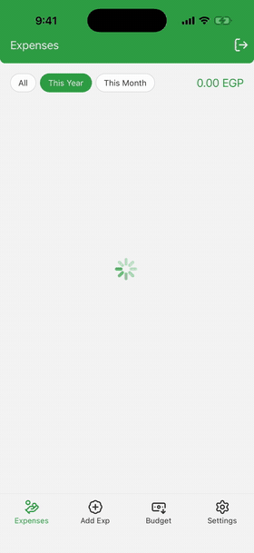

</div>

---

## Table of Contents

- [Demo Video](#demo-video)
- [Screenshots](#screenshots)
- [Features](#features)
- [Architecture](#architecture)
- [Tech Stack & Why](#tech-stack--why)
- [Project Structure](#project-structure)
- [Getting Started](#getting-started)
- [Author](#author)

## Demo Video

A full walkthrough (under 2 minutes) recorded on an iPhone 17 Pro simulator with a fresh demo account: sign up / log in, period filters and infinite scroll, add → edit → delete an expense, setting a budget, dark mode, switching to Arabic (RTL), and logging out.

▶️ **[Watch the demo video](docs/media/demo.mp4)**

## Screenshots

<table>
  <tr>
    <th>Login</th>
    <th>Sign up</th>
    <th>Expenses</th>
    <th>Add expense</th>
  </tr>
  <tr>
    <td>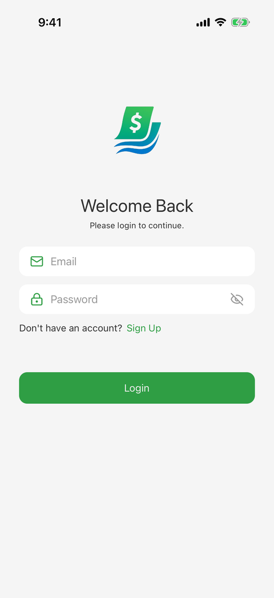</td>
    <td>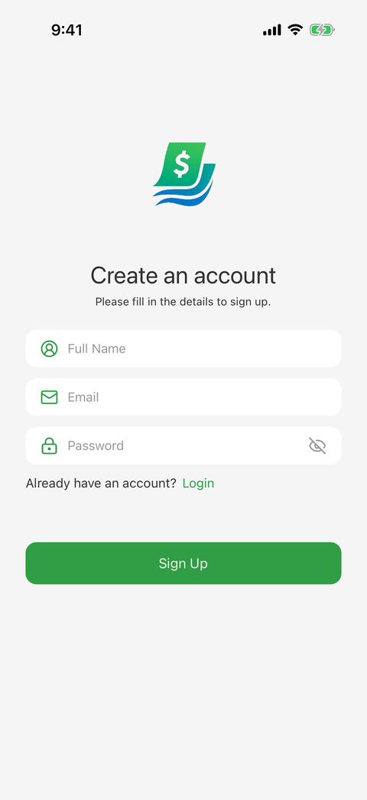</td>
    <td>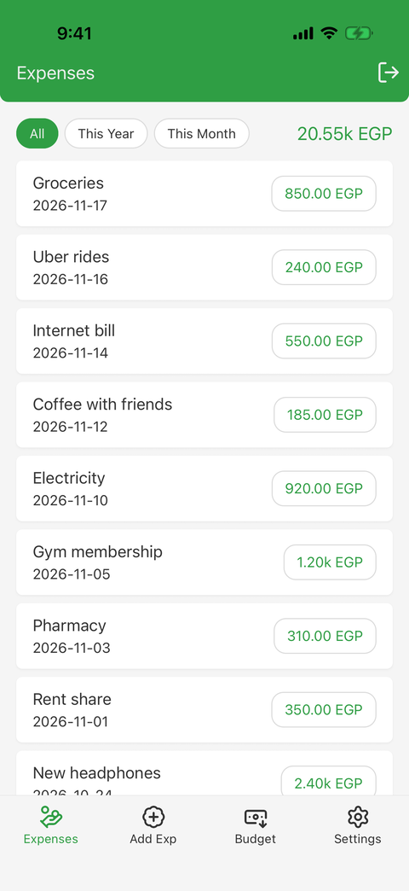</td>
    <td>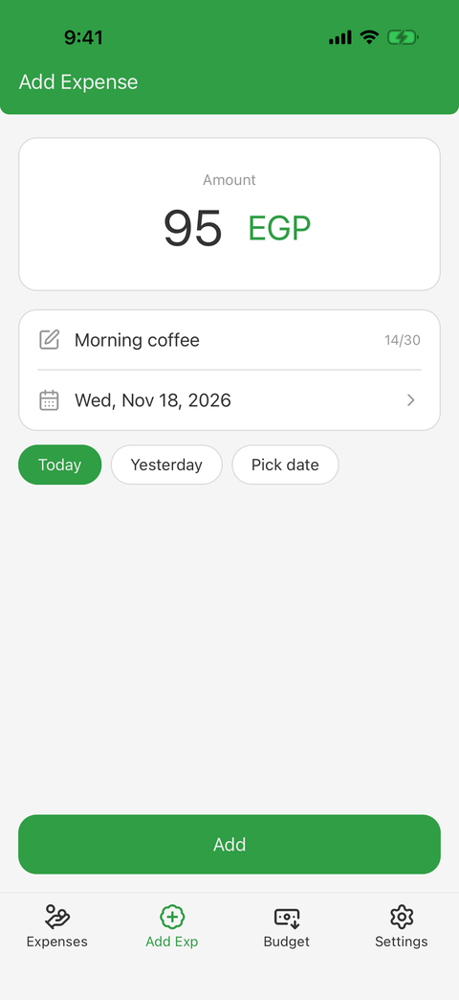</td>
  </tr>
  <tr>
    <th>Budget</th>
    <th>Settings</th>
    <th>Dark · Expenses</th>
    <th>Dark · Budget</th>
  </tr>
  <tr>
    <td>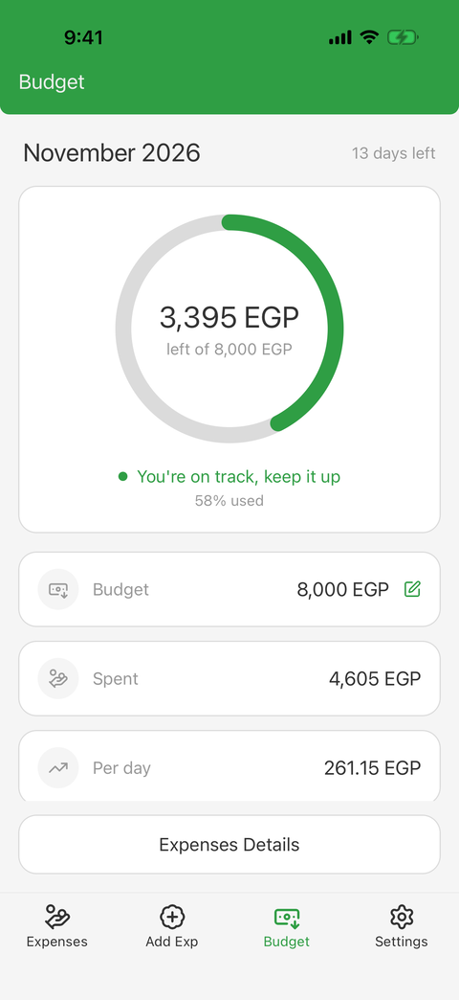</td>
    <td>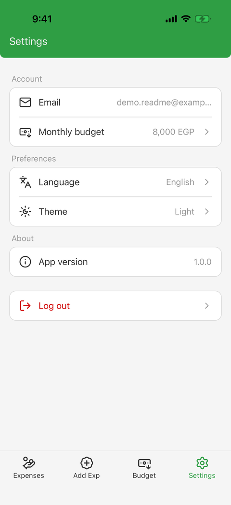</td>
    <td>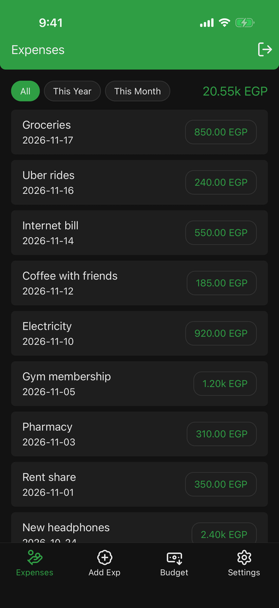</td>
    <td>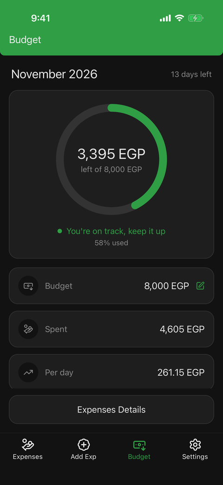</td>
  </tr>
  <tr>
    <th>Dark · Login</th>
    <th>العربية · النفقات</th>
    <th>العربية · الميزانية</th>
    <th></th>
  </tr>
  <tr>
    <td>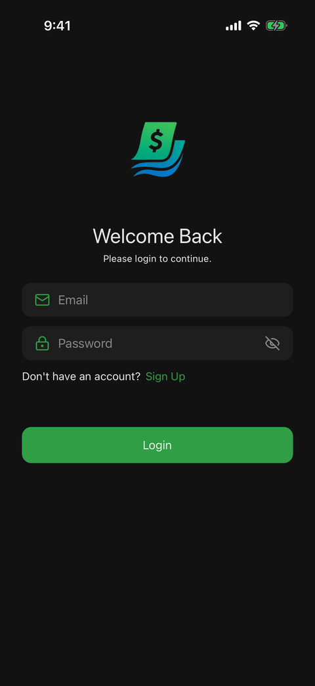</td>
    <td>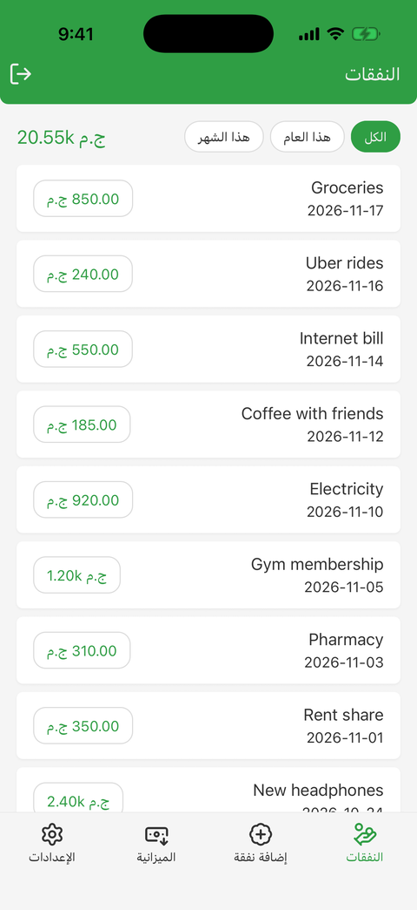</td>
    <td>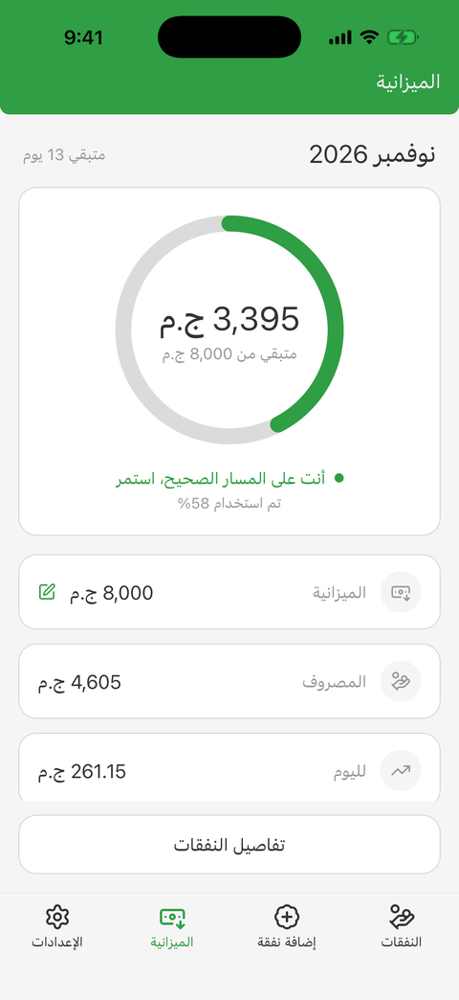</td>
    <td></td>
  </tr>
</table>

## Features

|                             |                                                                                                                                                                             |
| --------------------------- | --------------------------------------------------------------------------------------------------------------------------------------------------------------------------- |
| 🔐 **Authentication**       | Email/password sign up and login with Firebase Auth; the session survives app restarts.                                                                                     |
| 🧾 **Expense management**   | Add, edit and delete expenses with an amount-first form, a 30-character title, and quick date chips (Today / Yesterday / Pick date).                                        |
| 🔎 **Filters & pagination** | Switch between **All / This Year / This Month**. The list loads 10 items per page as you scroll, and the period total is calculated on the server.                          |
| 🎯 **Monthly budget**       | An animated ring shows what's left, plus a status (_on track_, _spending fast_, _over budget_), the percentage used, and a **per-day allowance** for the rest of the month. |
| 🌗 **Theming**              | Light, Dark, or follow the system, saved between launches and applied before the first frame so the screen never flashes the wrong theme.                                   |
| 🌍 **English & Arabic**     | Full RTL layout, localized currency (`EGP` / `ج.م`), and a per-app language setting that stays in sync with iOS/Android system settings.                                    |
| ✨ **Polish**               | Bottom-sheet pickers, confirmation modals, pull-to-refresh, scroll-driven list animations, and custom fonts per language.                                                   |

## Architecture

The app is organised by **feature**, not by file type. Each feature owns its screens, components, hooks and API calls. Code used by more than one feature lives in `shared/`.

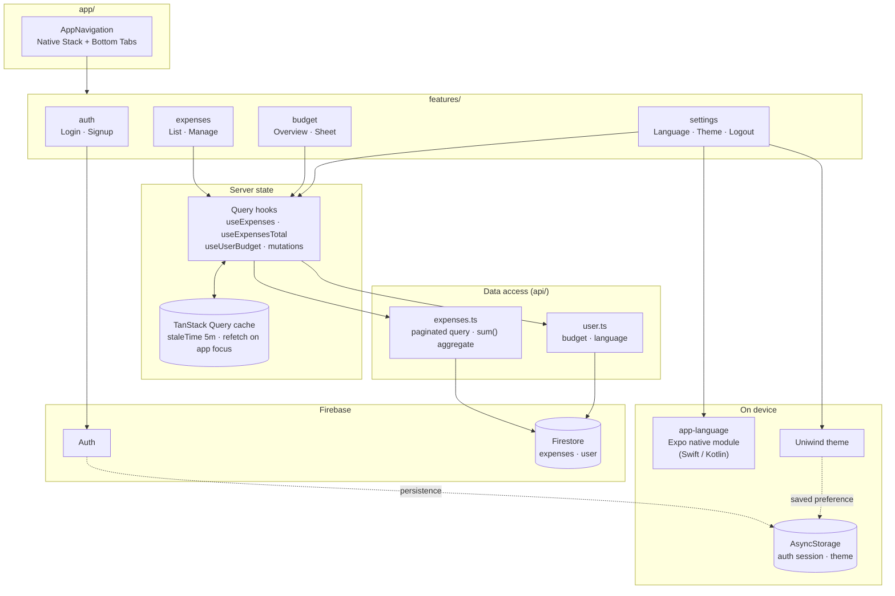

**How data moves:** screens never talk to Firebase directly. They call feature hooks, and the hooks wrap TanStack Query around small `api/` functions. A mutation (add / edit / delete) invalidates every query under the `["expenses"]` key, so the list, the period totals and the budget ring all refresh together.

**Firestore data model**

```text
expenses/{autoId}   { userId, title, amount, date: { seconds } }
user/{uid}          { budget, language }
```

Expenses are queried with `where(userId) + orderBy(date.seconds)` and paged with `startAfter(cursor)`. Totals come from `getAggregateFromServer(sum("amount"))`, so the app never downloads every document just to add them up.

## Tech Stack & Why

| Technology                                        | Why I chose it                                                                                                                                                                                                                  |
| ------------------------------------------------- | ------------------------------------------------------------------------------------------------------------------------------------------------------------------------------------------------------------------------------- |
| **React Native + Expo (SDK 57)**                  | One TypeScript codebase for iOS and Android. Expo handles native config, splash screen, fonts and localization, and still lets me write my own native module when I need one.                                                   |
| **TypeScript**                                    | Typed navigation params, query keys and API responses catch mistakes at compile time instead of at runtime.                                                                                                                     |
| **Firebase Auth + Firestore**                     | A secure backend without running a server. Auth handles credentials and sessions, and Firestore offers indexed queries, cursor pagination and server-side `sum()` aggregation.                                                  |
| **TanStack Query v5**                             | Replaces hand-written loading and error state with a cache: `useInfiniteQuery` drives pagination, mutations invalidate related queries, and the app refetches when it returns to the foreground.                                |
| **React Navigation 7**                            | Native stack and bottom tabs with real native transitions, plus type-safe route params.                                                                                                                                         |
| **Uniwind (Tailwind CSS v4)**                     | Tailwind classes compiled for React Native. Theme colours are CSS variables, so switching Light/Dark is a single call and RTL works with logical classes like `ms-` and `text-start`.                                           |
| **i18next + custom `app-language` native module** | i18next handles translations. The small Expo module (Swift + Kotlin) sets the **per-app language** natively, so text direction and system dialogs always match the language, and changes made in system settings are picked up. |
| **Reanimated 4 + Gesture Handler**                | Scroll-driven list animations and smooth bottom sheets that run on the UI thread.                                                                                                                                               |
| **@gorhom/bottom-sheet**                          | Native-feeling sheets for the budget input and the language/theme pickers.                                                                                                                                                      |
| **react-native-circular-progress + SVG**          | The animated budget ring, and crisp SVG icons that can be recoloured from the theme.                                                                                                                                            |
| **AsyncStorage**                                  | Keeps the Firebase Auth session and the theme preference on the device.                                                                                                                                                         |

## Project Structure

```text
src/
├── app/
│   ├── App.tsx                  # Providers: QueryClient, gestures, safe area, bottom sheets
│   └── navigation/              # Root stack + bottom tabs, splash & session restore
├── features/
│   ├── auth/screens/            # Login, Signup
│   ├── expenses/
│   │   ├── api/                 # Firestore queries, pagination, aggregates
│   │   ├── hooks/               # useExpenses, useExpensesTotal, mutations
│   │   ├── components/          # ExpenseItem, AnimatedExpenseItem, ExpensesOutput
│   │   └── screens/             # Expenses, ManageExpense
│   ├── budget/                  # Budget overview + AddOrUpdateBudget sheet
│   └── settings/                # Settings, OptionPicker, SettingsRow
├── shared/
│   ├── api/                     # queryClient, user (budget, language)
│   ├── components/              # Button, Input, ConfirmModal, NavigationHeader…
│   ├── config/firebase.ts
│   ├── hooks/                   # useUserBudget
│   ├── i18n/                    # en/ar strings, language preference
│   ├── theme/                   # colors, fonts, theme preference
│   └── utils/
└── assets/                      # fonts, icons, svgs
modules/app-language/            # Expo native module (iOS Swift / Android Kotlin)
```

## Getting Started

**Prerequisites:** Node 20+, Xcode (for iOS) and/or Android Studio (for Android).

> The app includes a custom native module, so it needs a **development build**. It will not run in Expo Go.

```bash
git clone https://github.com/MostafaHamdy3/Expenses_Tracker.git
cd Expenses_Tracker
npm install

# Build and run a development build
npm run ios       # or: npm run android

# Later runs: just start Metro
npm start
```

## Author

<div align="center">

**Mostafa Hamdy**
React | React Native Developer

[](https://mostafa7amdy.netlify.app/)
[](https://www.linkedin.com/in/mostafa-7amdy/)
[](mailto:mostafa44hamdy@gmail.com)

</div>
